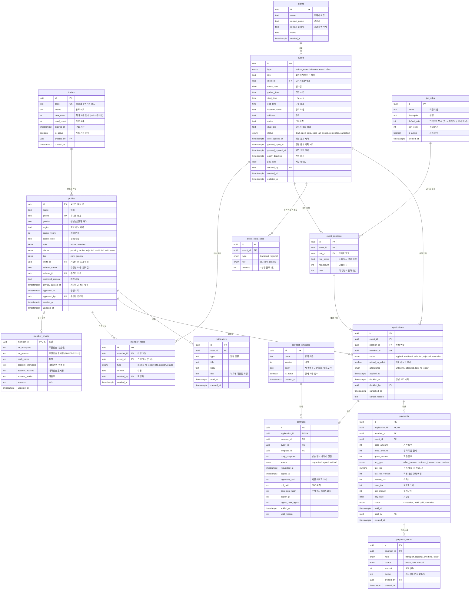

# 원스텝 인력관리 앱 ERD

| 항목 | 내용 |
|---|---|
| 문서 버전 | v0.1 (초안) |
| 최종 수정 | 2026-10-26 |
| 데이터베이스 | PostgreSQL (Supabase) |
| 관련 문서 | [PRD](./PRD.md) · [기술 스택](./TECH_STACK.md) |

## 1. 전체 관계도

다음 테이블은 핵심 업무 흐름과 직접 연결되지 않아 그림에서 뺐다.

| 테이블 | 용도 | 주요 컬럼 |
|---|---|---|
| `app_settings` | PRD의 현재 설정(SET-01~11) 값. 지방비 기본표(SET-10), 직인 이미지 위치(SET-11) 포함 | `key` (PK), `value` (jsonb), `version`, `effective_from`, `updated_by`, `updated_at` |
| `app_settings_history` | 세목·지급일 등 설정의 변경 이력 | `id`, `key`, `value` (jsonb), `version`, `effective_from`, `changed_by`, `change_reason`, `changed_at` |
| `audit_logs` | 민감정보 열람, 이체 엑셀 다운로드, 등급·제한 변경 기록 | `id`, `actor_id`, `action`, `target_type`, `target_id`, `detail` (jsonb), `created_at` |

## 2. 설계 원칙

### 2.1 민감정보 분리
주민번호, 계좌번호, 주소는 `profiles`가 아닌 `member_private`에 따로 둔다.
- 회원 목록처럼 자주 보는 화면에서 민감정보가 함께 읽히지 않는다.
- 주민번호와 계좌번호는 **서버에서 암호화한 값**만 저장한다. 암호화 키는 데이터베이스가 아닌 배포 서버의 환경변수에 둔다. 데이터베이스가 유출돼도 키 없이는 원문을 볼 수 없다.
- 화면에는 `*_masked` 값만 보여 준다. 원문 복호화는 대표가 이체 엑셀을 받을 때 등 서버 안에서만 하고, `audit_logs`에 기록한다.

### 2.2 당시 값 저장 (스냅샷)
나중에 원본이 바뀌어도 과거 기록이 바뀌지 않도록, 그 시점의 값을 복사해 둔다.

| 테이블 | 저장하는 값 | 이유 |
|---|---|---|
| `event_positions` | `role_name`, `rate` | 단가표를 바꿔도 지난 일정 단가는 그대로 |
| `event_extra_rules` | `amount` | 지방비 기본표를 바꿔도 이미 등록한 일정의 금액은 그대로 |
| `payment_extras` | `amount`, `source` | 일정의 기본값을 나중에 바꿔도 이미 만든 지급 항목은 그대로. 자동으로 붙은 것인지 대표가 넣은 것인지 구분 |
| `contracts` | `body_snapshot`, `document_hash` | 양식을 고쳐도 서명한 계약서 내용은 그대로, 위·변조 확인 가능 |
| `payments` | `tax_type`, `tax_rate`, `tax_rule_version`, 세액 | 세목·계산 규칙을 바꿔도 과거 지급 내역은 그대로 |

### 2.3 상태값

| 대상 | 상태 흐름 |
|---|---|
| 회원 `status` | `pending`(승인 대기) → `active`(활동) 또는 `rejected`(거절). `active` ↔ `restricted`(제한). 탈퇴 시 `withdrawn` |
| 일정 `status` | `draft` → `open_core` → `open_all` → `closed` → `completed`. 어느 단계에서든 `cancelled` |
| 신청 `status` | `applied` → `selected` / `waitlisted` / `rejected`. `waitlisted` → `selected` 가능. 취소 시 `cancelled` |
| 계약 `status` | `requested` → `signed`. 확정 취소 시 `voided` |
| 지급 `status` | `scheduled` → `paid`. 필요 시 `held`(보류), `cancelled` |

### 2.4 제약 조건
- `profiles.phone` 중복 불가: 한 사람이 카카오·구글로 두 번 가입하는 것을 막는다.
- `applications (event_id, member_id)` 중복 불가: 한 일정에 한 번만 신청
- `contracts.application_id`, `payments.application_id` 중복 불가: 확정 1건당 계약 1건, 지급 1건
- 금액은 모두 원 단위 정수(`int`)로 저장한다. 소수 계산 오차를 피하기 위해서다.

## 3. 접근 권한 (RLS)

| 테이블 | 관리자 | 회원 본인 | 다른 회원 |
|---|---|---|---|
| `profiles` | 전체 읽기·쓰기 | 자기 행 읽기, 일부 수정 (이름·연락처·지역·경력) | 불가 |
| `member_private` | 서버를 통해서만 (열람 기록) | 서버를 통해 자기 정보 입력·수정, 마스킹 값만 읽기 | 불가 |
| `invites` | 전체 | 불가 (가입 시 서버가 코드 검증) | 불가 |
| `member_notes` | 전체 | **불가** | 불가 |
| `job_roles` | 전체 | 읽기 | 읽기 |
| `clients` | 전체 | **불가** | 불가 |
| `events` | 전체 | 공개된 일정만 읽기 (고객사 제외한 보기 화면 사용) | 같음 |
| `event_positions` | 전체 | 공개된 일정의 것만 읽기 | 같음 |
| `event_extra_rules` | 전체 | 공개된 일정의 것만 읽기 (화면에는 자기 등급 금액만) | 같음 |
| `applications` | 전체 | 자기 신청 읽기·생성·취소 | 불가 (남은 자리 수만 공개) |
| `contract_templates` | 전체 | 불가 | 불가 |
| `contracts` | 전체 | 자기 계약 읽기·서명 | 불가 |
| `payments` | 전체 | 자기 내역 읽기 | 불가 |
| `payment_extras` | 전체 | 자기 지급 항목의 것 읽기 | 불가 |
| `notifications` | 생성 | 자기 알림 읽기·읽음 처리 | 불가 |
| `app_settings` | 전체 | 불가 | 불가 |
| `app_settings_history` | 읽기 | 불가 | 불가 |
| `audit_logs` | 읽기 (쓰기는 서버만) | 불가 | 불가 |

`member_private`는 행 단위 보안만으로 암호문·마스킹 컬럼의 읽기 권한을 나눌 수 없다. 회원에게 원본 테이블의 직접 조회 권한을 주지 않고, 서버 경로 또는 필요한 마스킹 컬럼만 노출하는 별도 인터페이스로 제공한다. 관리자 키는 서버에서만 사용하고, 서버 경로에서 대표 권한 확인과 열람 기록을 남긴다.

**일정 공개 규칙**
- 회원 상태가 `active`가 아니면 일정을 하나도 볼 수 없다.
- `open_core`: 핵심(`core`) 회원만 본다.
- `open_all`, `closed`, `completed`: 활동 회원 모두 본다. 단, 지난 일정은 자기가 신청한 것만 본다.
- `draft`: 관리자만 본다.
