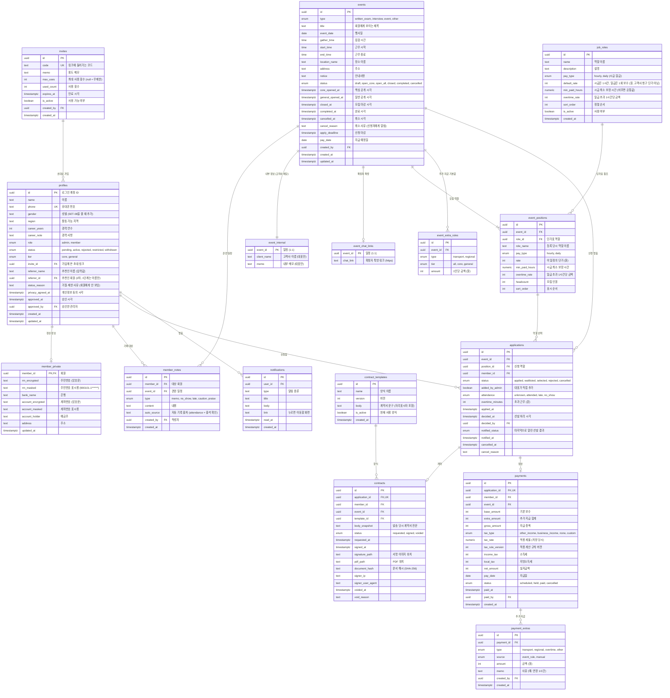

# 원스텝 인력관리 앱 ERD

| 항목 | 내용 |
|---|---|
| 문서 버전 | v0.1 (초안) |
| 최종 수정 | 2026-10-27 (2단계 일정·신청 반영) |
| 데이터베이스 | PostgreSQL (Supabase) |
| 관련 문서 | [PRD](./PRD.md) · [기술 스택](./TECH_STACK.md) |

## 1. 전체 관계도

다음 테이블은 핵심 업무 흐름과 직접 연결되지 않아 그림에서 뺐다.

| 테이블 | 용도 | 주요 컬럼 |
|---|---|---|
| `app_settings` | PRD의 현재 설정(SET-01~11) 값. 지방비 기본표(SET-10), 직인 이미지 위치(SET-11) 포함 | `key` (PK), `value` (jsonb), `version`, `effective_from`, `updated_by`, `updated_at` |
| `app_settings_history` | 세목·지급일 등 설정의 변경 이력 | `id`, `key`, `value` (jsonb), `version`, `effective_from`, `changed_by`, `change_reason`, `changed_at` |
| `audit_logs` | 민감정보 열람, 이체 엑셀 다운로드, 등급·제한 변경 기록 | `id`, `actor_id`, `action`, `target_type`, `target_id`, `detail` (jsonb), `created_at` |
| `member_note_counts` (보기) | 회원별 노쇼·지각 횟수. 호출한 사람의 권한으로 계산 (`security_invoker`) | `member_id`, `no_show_count`, `late_count`, `last_note_at` |
| `member_participation` (보기) | 회원별 참여 횟수 (확정되고 참석·지각으로 확인된 일정 수). `security_invoker` | `member_id`, `attended_count` |
| `clients` (나중에) | 고객사 목록. MVP에서는 일정마다 `event_internal.client_name`에 이름만 적는다. 반복 고객이 많아지면 만든다 | `id`, `name`, `contact_name`, `contact_phone`, `memo` |

## 2. 설계 원칙

### 2.1 민감정보 분리
주민번호, 계좌번호, 주소는 `profiles`가 아닌 `member_private`에 따로 둔다.
- 회원 목록처럼 자주 보는 화면에서 민감정보가 함께 읽히지 않는다.
- 주민번호와 계좌번호는 **서버에서 암호화한 값**만 저장한다. 암호화 키는 데이터베이스가 아닌 배포 서버의 환경변수에 둔다. 데이터베이스가 유출돼도 키 없이는 원문을 볼 수 없다.
- 화면에는 `*_masked` 값만 보여 준다. 원문 복호화는 대표가 이체 엑셀을 받을 때 등 서버 안에서만 하고, `audit_logs`에 기록한다.

### 2.2 당시 값 저장 (스냅샷)
나중에 원본이 바뀌어도 과거 기록이 바뀌지 않도록, 그 시점의 값을 복사해 둔다.

| 테이블 | 저장하는 값 | 이유 |
|---|---|---|
| `event_positions` | `role_name`, `rate` | 단가표를 바꿔도 지난 일정 단가는 그대로 |
| `event_extra_rules` | `amount` | 지방비 기본표를 바꿔도 이미 등록한 일정의 금액은 그대로 |
| `payment_extras` | `amount`, `source` | 일정의 기본값을 나중에 바꿔도 이미 만든 지급 항목은 그대로. 자동으로 붙은 것인지 대표가 넣은 것인지 구분 |
| `contracts` | `body_snapshot`, `document_hash` | 양식을 고쳐도 서명한 계약서 내용은 그대로, 위·변조 확인 가능 |
| `payments` | `tax_type`, `tax_rate`, `tax_rule_version`, 세액 | 세목·계산 규칙을 바꿔도 과거 지급 내역은 그대로 |

### 2.3 상태값

| 대상 | 상태 흐름 |
|---|---|
| 회원 `status` | `pending`(승인 대기) → `active`(활동) 또는 `rejected`(거절). `active` ↔ `restricted`(제한). 탈퇴 시 `withdrawn` |
| 일정 `status` | `draft` → `open_core` → `open_all` → `closed` → `completed`. 어느 단계에서든 `cancelled` |
| 신청 `status` | `applied` → `selected` / `waitlisted` / `rejected`. `waitlisted` → `selected` 가능. 취소 시 `cancelled` |
| 계약 `status` | `requested` → `signed`. 확정 취소 시 `voided` |
| 지급 `status` | `scheduled` → `paid`. 필요 시 `held`(보류), `cancelled` |

### 2.4 제약 조건
- `profiles.phone` 중복 불가: 한 사람이 카카오·구글로 두 번 가입하는 것을 막는다.
- `applications (event_id, member_id)` 중복 불가: 한 일정에 한 번만 신청
- `contracts.application_id`, `payments.application_id` 중복 불가: 확정 1건당 계약 1건, 지급 1건
- 금액은 모두 원 단위 정수(`int`)로 저장한다. 소수 계산 오차를 피하기 위해서다.

## 3. 접근 권한 (RLS)

| 테이블 | 관리자 | 회원 본인 | 다른 회원 |
|---|---|---|---|
| `profiles` | 전체 읽기·쓰기 | 자기 행 읽기, 일부 수정 (이름·연락처·지역·경력) | 불가 |
| `member_private` | 서버를 통해서만 (열람 기록) | 서버를 통해 자기 정보 입력·수정, 마스킹 값만 읽기 | 불가 |
| `invites` | 전체 | 불가 (가입 시 서버가 코드 검증) | 불가 |
| `member_notes` | 전체 | **불가** | 불가 |
| `job_roles` | 전체 | 읽기 | 읽기 |
| `events` | 전체 | 볼 수 있는 일정만 읽기 (아래 공개 규칙). 고객사는 이 테이블에 없음 | 같음 |
| `event_internal` | 전체 | **불가** | 불가 |
| `event_chat_links` | 전체 | 확정되고 **결과 알림을 받은** 일정의 것만 읽기 | 불가 |
| `event_positions` | 전체 | 볼 수 있는 일정의 것만 읽기 | 같음 |
| `event_extra_rules` | 전체 | 볼 수 있는 일정의 것만 읽기 (화면에는 자기 등급 금액만) | 같음 |
| `applications` | 전체 | 자기 신청 읽기. 신청·취소는 함수로만 | 불가 (역할별 확정 인원만 `position_selected_counts`로 공개) |
| `contract_templates` | 전체 | 불가 | 불가 |
| `contracts` | 전체 | 자기 계약 읽기·서명 | 불가 |
| `payments` | 전체 | 자기 내역 읽기 | 불가 |
| `payment_extras` | 전체 | 자기 지급 항목의 것 읽기 | 불가 |
| `notifications` | 생성 | 자기 알림 읽기·읽음 처리 | 불가 |
| `app_settings` | 전체 | 보수 계산 규칙(`pay_rules`)만 읽기 (예상 보수 표시용) | 같음 |
| `app_settings_history` | 읽기 | 불가 | 불가 |
| `audit_logs` | 읽기 (쓰기는 서버만) | 불가 | 불가 |
| `member_note_counts` | 읽기 | 불가 (0행) | 불가 |
| `member_participation` | 읽기 | 자기 행만 | 불가 |

`member_private`는 행 단위 보안만으로 암호문·마스킹 컬럼의 읽기 권한을 나눌 수 없다. 회원에게 원본 테이블의 직접 조회 권한을 주지 않고, 서버 경로 또는 필요한 마스킹 컬럼만 노출하는 별도 인터페이스로 제공한다. 관리자 키는 서버에서만 사용하고, 서버 경로에서 대표 권한 확인과 열람 기록을 남긴다.

**일정 공개 규칙**
- 회원 상태가 `active`가 아니면 일정을 하나도 볼 수 없다.
- `draft`: 관리자만 본다.
- `open_core`: 핵심(`core`) 회원과, 이미 신청한 회원이 본다.
- `open_all`, `closed`: 활동 회원 모두 본다.
- `completed`, `cancelled`: 그 일정에 신청했던 회원만 본다.
- 규칙은 `can_view_event(id, status)` 함수 하나에 모아 두고, 권한 규칙과 DB 함수가 같이 쓴다.
- 회원 화면은 확정·미선발 결과를 **대표가 결과 알림을 보낸 뒤에만** 보여 준다. 톡방 링크도 그때부터 보인다.

## 4. DB 함수 (1단계)
회원 상태·등급을 바꾸는 일은 테이블을 직접 고치지 않고 아래 함수로만 한다. 함수가 대표인지 확인하고 `audit_logs`에 기록을 남긴다. 오류는 영문 코드로 돌려주고, 화면이 `src/lib/errors.ts`에서 한국어로 바꾼다.

| 함수 | 누가 | 하는 일 |
|---|---|---|
| `check_invite(code)` | 누구나 | 초대 링크를 쓸 수 있는지만 알려 줌 |
| `submit_application(...)` | 로그인한 사람 | 초대 링크 확인 → 입력 검사 → 승인 대기 회원 생성 → 링크 사용 횟수 증가 |
| `approve_member(id, tier)` | 대표 | 승인 + 등급 지정. 관리자 기록에 가입·추천인 자동 기록 |
| `reject_member(id, reason)` | 대표 | 거절 + 사유 저장 |
| `set_member_tier(id, tier)` | 대표 | 등급 변경 (활동·제한 회원) |
| `restrict_member(id, reason)` | 대표 | 활동 제한. 사유 필수, 대표 계정은 불가. 관리자 기록에 "주의"로 자동 기록 |
| `unrestrict_member(id)` | 대표 | 제한 해제 |
| `update_pay_rules(...)` | 대표 | 보수 계산 규칙(초과 배율, 계산 단위·단위 미만 처리, 기본 최소 보장 시간) 변경. 값 검사, 버전 증가, `app_settings_history`에 이력 |
| `is_admin()`, `is_active_member()` | 권한 규칙 안에서 | 지금 사람이 활동 중인 대표/회원인지 |

## 5. DB 함수 (2단계: 일정·신청)
일정과 신청도 테이블을 직접 고치지 않고 아래 함수로만 바꾼다. 알림(`notifications`)도 함수 안에서 같이 만든다.

| 함수 | 누가 | 하는 일 |
|---|---|---|
| `create_event(event, positions, extras, client_name, memo)` | 대표 | 임시저장 일정 생성. 모집 역할은 단가표 값을 복사해 저장 |
| `update_event(id, ...)` | 대표 | 일정 수정. 신청자가 있는 역할은 지울 수 없음(`POSITION_IN_USE`), 완료·취소 일정은 수정 불가(`EVENT_LOCKED`) |
| `set_event_status(id, status, reason)` | 대표 | 공개·마감·완료·취소. 처음 공개할 때 볼 수 있는 회원에게 알림, 취소는 사유 필수이며 신청자에게 알림 |
| `apply_to_event(event_id, position_id)` | 활동 회원 | 신청. 공개 범위·마감 시각 확인, 한 일정에 한 번(`ALREADY_APPLIED_EVENT`). 취소했던 신청은 다시 낼 수 있음 |
| `cancel_application(event_id, reason)` | 활동 회원 | 확정 전 신청 취소. 확정 뒤에는 `ASK_ADMIN` (PRD SET-06 ①) |
| `decide_applications(ids, status)` | 대표 | 여러 신청을 한 번에 확정·대기·미선발·처리 전으로. 확정이 풀리면 출석·초과 시간과 자동 기록을 지움 |
| `add_member_to_event(event_id, position_id, member_id)` | 대표 | 신청하지 않은 회원을 확정자로 직접 추가 |
| `notify_selection_results(event_id)` | 대표 | 확정·미선발이 바뀐 사람에게만 결과 알림. 다시 눌러도 같은 알림은 안 보냄 |
| `set_attendance(application_id, attendance, overtime_minutes)` | 대표 | 출석·초과 시간 저장. 노쇼·지각은 관리자 기록에 자동으로 남기고, 바꾸면 자동 기록도 바뀜 |
| `position_selected_counts(event_ids)` | 활동 회원 | 볼 수 있는 일정의 역할별 확정 인원 (남은 자리 표시) |
| `can_view_event(id, status)` | 권한 규칙 안에서 | 위의 일정 공개 규칙 |
