# 원스텝 인력관리 앱 ERD

| 항목 | 내용 |
|---|---|
| 문서 버전 | v0.1 (초안) |
| 최종 수정 | 2026-10-27 (3·4단계: 정산 정보 암호화, 전자계약, 정산) |
| 데이터베이스 | PostgreSQL (Supabase) |
| 관련 문서 | [PRD](./PRD.md) · [기술 스택](./TECH_STACK.md) |

## 1. 전체 관계도

```mermaid
erDiagram
    profiles ||--o| member_private : "정산 정보"
    invites ||--o{ profiles : "초대로 가입"
    profiles ||--o{ member_notes : "기록 대상"
    events ||--o{ member_notes : "관련 일정"
    events ||--|| event_internal : "내부 정보 (고객사·메모)"
    events ||--o| event_chat_links : "확정자 톡방"
    events ||--|{ event_days : "날짜 (세팅일·진행일)"
    events ||--o{ event_extra_rules : "추가 지급 기본값"
    events ||--o{ applications : "신청 받음"
    event_days ||--o{ applications : "날짜별 신청"
    profiles ||--o{ applications : "신청함"
    events ||--o{ contracts : "계약 (사람당 유효 1장)"
    profiles ||--o{ contracts : "서명함"
    contract_templates ||--o{ contracts : "양식"
    events ||--o{ payments : "정산 (사람당 1건)"
    profiles ||--o{ payments : "받음"
    payments ||--|{ payment_items : "지급 항목"
    profiles ||--o{ notifications : "받음"

    profiles {
        uuid id PK "로그인 계정 ID"
        text name "이름"
        text phone UK "휴대폰 번호"
        int default_rate "회원 기본 시급 (대표가 정함, 비면 일정 단가)"
        text gender "성별 (SET-08을 켤 때 추가)"
        text region "활동 가능 지역"
        int career_years "경력 연수"
        text career_note "경력 사항"
        enum role "admin, member"
        enum status "pending, active, rejected, restricted, withdrawn"
        enum tier "core, general"
        uuid invite_id FK "가입에 쓴 초대 링크"
        text referrer_name "추천인 이름 (입력값)"
        uuid referrer_id FK "추천인 회원 (2차, 1단계는 이름만)"
        text status_reason "거절·제한 사유 (회원에게 안 보임)"
        timestamptz privacy_agreed_at "개인정보 동의 시각"
        timestamptz approved_at "승인 시각"
        uuid approved_by FK "승인한 관리자"
        timestamptz created_at
        timestamptz updated_at
    }

    member_private {
        uuid member_id PK, FK "회원"
        text rrn_enc "주민번호 (암호문, v1:...)"
        text rrn_masked "주민번호 표시용 (900101-1******)"
        text bank_name "은행"
        text account_enc "계좌번호 (암호문, v1:...)"
        text account_masked "계좌번호 표시용 (****1234)"
        text account_holder "예금주"
        text address "주소"
        timestamptz updated_at
    }

    invites {
        uuid id PK
        text code UK "링크에 들어가는 코드"
        text memo "용도 메모"
        int max_uses "최대 사용 횟수 (null = 무제한)"
        int used_count "사용 횟수"
        timestamptz expires_at "만료 시각"
        boolean is_active "사용 가능 여부"
        uuid created_by FK
        timestamptz created_at
    }

    member_notes {
        uuid id PK
        uuid member_id FK "대상 회원"
        uuid event_id FK "관련 일정"
        enum type "memo, no_show, late, caution, praise"
        text content "내용"
        text auto_source "자동 기록 출처 (attendance = 출석 확인)"
        uuid application_id FK "자동 기록을 만든 날짜별 신청"
        uuid created_by FK "작성자"
        timestamptz created_at
    }

    job_roles {
        uuid id PK
        text name "역할 이름"
        text description "설명"
        enum pay_type "hourly, daily (시급·일급)"
        int default_rate "시급은 1시간, 일급은 1회 보수 (원, 고객사 청구 단가 아님)"
        numeric min_paid_hours "시급 최소 보장 시간 (비우면 공통값)"
        int overtime_rate "일급 초과 1시간당 금액"
        enum default_for "setup, main (세팅일·진행일 기본, 종류마다 하나)"
        int sort_order "정렬 순서"
        boolean is_active "사용 여부"
        timestamptz created_at
    }

    event_internal {
        uuid event_id PK "일정 (1:1)"
        text client_name "고객사 이름 (대표만)"
        text memo "내부 메모 (대표만)"
    }

    event_chat_links {
        uuid event_id PK "일정 (1:1)"
        text chat_link "확정자 톡방 링크 (https)"
    }

    events {
        uuid id PK
        enum type "written_exam, interview, event, other"
        text title "회원에게 보이는 제목"
        date start_date "첫날 (날짜 목록에서 계산)"
        date end_date "마지막 날"
        boolean all_days_required "모든 날짜 참여 필수"
        text location_name "장소 이름"
        text address "주소"
        text notice "안내사항"
        enum status "draft, open_core, open_all, closed, completed, cancelled"
        timestamptz core_opened_at "핵심 공개 시각"
        timestamptz general_opened_at "일반 공개 시각"
        timestamptz closed_at "모집 마감 시각"
        timestamptz completed_at "완료 시각"
        timestamptz cancelled_at "취소 시각"
        text cancel_reason "취소 사유 (신청자에게 알림)"
        timestamptz apply_deadline "신청 마감"
        date pay_date "지급 예정일"
        uuid created_by FK
        timestamptz created_at
        timestamptz updated_at
    }

    event_days {
        uuid id PK
        uuid event_id FK
        date day_date "날짜"
        enum kind "setup, main, other (세팅·진행·기타)"
        time gather_time "집합 시간"
        time start_time "근무 시작"
        time end_time "근무 종료"
        int sort_order "표시 순서"
        int headcount "모집 인원"
        enum pay_type "hourly, daily"
        int rate "이 날의 단가 (원, 처음 값은 기본 시급)"
        numeric min_paid_hours "시급 최소 보장 시간"
        int overtime_rate "일급 초과 1시간당 금액"
    }

    applications {
        uuid id PK
        uuid event_id FK
        uuid day_id FK "날짜 (날짜마다 한 줄)"
        text role_name "대표가 정한 역할 (비면 미정)"
        int rate_override "이 일정에서 이 사람만 다른 단가"
        uuid member_id FK
        enum status "applied, waitlisted, selected, rejected, cancelled"
        boolean added_by_admin "대표가 직접 추가"
        enum attendance "unknown, attended, late, no_show"
        int overtime_minutes "초과 근무 (분)"
        timestamptz applied_at
        timestamptz decided_at "선발 처리 시각"
        uuid decided_by FK
        enum notified_status "마지막으로 알린 선발 결과"
        timestamptz notified_at
        timestamptz cancelled_at
        text cancel_reason
    }

    contract_templates {
        uuid id PK
        int version UK "버전 (고칠 때마다 새 줄)"
        text title "계약서 제목"
        text body "계약서 문구 ({{빈칸}} 포함)"
        uuid created_by FK
        timestamptz created_at
    }

    contracts {
        uuid id PK
        uuid event_id FK
        uuid member_id FK
        uuid template_id FK
        int template_version "보낼 때의 양식 버전"
        enum status "requested, signed, voided"
        text title
        text body "보낼 때 빈칸을 채운 계약서 전문"
        jsonb terms "회사·회원·날짜별 보수·합계·지급일 (보낼 때 값)"
        timestamptz requested_at
        timestamptz notified_at "마지막 알림"
        timestamptz signed_at
        text signature "서명 이미지 (PNG data URL)"
        text signer_rrn_masked "서명 때의 가린 주민번호"
        text signer_address "서명 때의 주소"
        text sign_ip
        text sign_user_agent
        text document_hash "문서 해시 (SHA-256, DB가 계산)"
        timestamptz voided_at
        text void_reason
    }

    payments {
        uuid id PK
        uuid event_id FK
        uuid member_id FK
        date pay_date "지급 예정일"
        enum status "draft, scheduled, held, paid, cancelled"
        int work_amount "근무·초과 보수"
        int extra_amount "교통비·지방비·기타"
        int gross "세전 합계"
        text tax_type "unset, other, business, none (저장 당시)"
        jsonb tax_rule "세율·과세최저한·교통비 포함 여부 (저장 당시)"
        int income_tax "소득세"
        int local_tax "지방소득세"
        int net "실지급액"
        boolean edited "대표가 직접 고침"
        text memo
        text held_reason
        timestamptz confirmed_at
        timestamptz paid_at
    }

    event_extra_rules {
        uuid id PK
        uuid event_id FK
        enum type "transport, regional"
        enum tier "all, core, general"
        int amount "1인당 금액 (원)"
        boolean per_day "참여한 날마다(true) / 일정당 한 번(false)"
    }

    payment_items {
        uuid id PK
        uuid payment_id FK
        text kind "work, overtime, transport, regional, other"
        text label "예: 11/7(토) 세팅 · 시급 11,000원 × 4시간"
        int amount "금액 (원)"
        uuid day_id FK "관련 날짜 (없을 수 있음)"
        int sort_order
    }

    notifications {
        uuid id PK
        uuid user_id FK
        text type "알림 종류"
        text title
        text body
        text link "누르면 이동할 화면"
        timestamptz read_at
        timestamptz created_at
    }
```

다음 테이블은 핵심 업무 흐름과 직접 연결되지 않아 그림에서 뺐다.

| 테이블 | 용도 | 주요 컬럼 |
|---|---|---|
| `app_settings` | PRD의 현재 설정(SET-01~11) 값. 지방비 기본표(SET-10), 직인 이미지 위치(SET-11) 포함 | `key` (PK), `value` (jsonb), `version`, `effective_from`, `updated_by`, `updated_at` |
| `app_settings_history` | 세목·지급일 등 설정의 변경 이력 | `id`, `key`, `value` (jsonb), `version`, `effective_from`, `changed_by`, `change_reason`, `changed_at` |
| `audit_logs` | 민감정보 열람, 이체 엑셀 다운로드, 등급·제한 변경 기록 | `id`, `actor_id`, `action`, `target_type`, `target_id`, `detail` (jsonb), `created_at` |
| `member_note_counts` (보기) | 회원별 노쇼·지각 횟수. 호출한 사람의 권한으로 계산 (`security_invoker`) | `member_id`, `no_show_count`, `late_count`, `last_note_at` |
| `member_participation` (보기) | 회원별 참여 횟수 (참석·지각한 날이 하루라도 있는 일정 수). `security_invoker` | `member_id`, `attended_count` |
| `developers` | 개발자 화면(`/dev`)을 볼 로그인 계정. 회원(profiles)이 아니어도 된다. SQL로만 넣는다 | `user_id` (PK), `note`, `created_at` |
| `app_errors` | 오류 기록 (서버·버튼·브라우저·로그인). 개발자만 함수로 읽는다. 180일 뒤 지움 | `id`, `created_at`, `user_id`, `source`, `level` (error·warn), `code`, `message`, `path`, `digest`, `user_agent`, `detail` (jsonb), `resolved_at`, `resolved_note` |
| `clients` (나중에) | 고객사 목록. MVP에서는 일정마다 `event_internal.client_name`에 이름만 적는다. 반복 고객이 많아지면 만든다 | `id`, `name`, `contact_name`, `contact_phone`, `memo` |

## 2. 설계 원칙

### 2.1 민감정보 분리
주민번호, 계좌번호, 주소는 `profiles`가 아닌 `member_private`에 따로 둔다.
- 회원 목록처럼 자주 보는 화면에서 민감정보가 함께 읽히지 않는다.
- 주민번호와 계좌번호는 **서버에서 암호화한 값**만 저장한다. 암호화 키는 데이터베이스가 아닌 배포 서버의 환경변수에 둔다. 데이터베이스가 유출돼도 키 없이는 원문을 볼 수 없다.
- 화면에는 `*_masked` 값만 보여 준다. 원문 복호화는 대표가 이체 엑셀을 받을 때 등 서버 안에서만 하고, `audit_logs`에 기록한다.

### 2.2 당시 값 저장 (스냅샷)
나중에 원본이 바뀌어도 과거 기록이 바뀌지 않도록, 그 시점의 값을 복사해 둔다.

| 테이블 | 저장하는 값 | 이유 |
|---|---|---|
| `event_days` | `rate`, `pay_type` 등 (날짜별) | 단가표·기본 시급을 바꿔도 지난 일정 단가는 그대로 |
| `event_extra_rules` | `amount` | 지방비 기본표를 바꿔도 이미 등록한 일정의 금액은 그대로 |
| `payment_items` | `label`, `amount` | 일정 단가·추가 지급을 나중에 바꿔도 이미 만든 지급 항목은 그대로 |
| `contracts` | `body`, `terms`, `document_hash` | 양식·회사 정보·단가를 고쳐도 보낸 계약서 내용은 그대로, 위·변조 확인 가능 |
| `payments` | `tax_type`, `tax_rule`, 세액, `edited` | 세목·계산 규칙을 바꿔도 과거 지급 내역은 그대로. 대표가 직접 고친 정산은 자동 재계산이 덮어쓰지 않음 |

### 2.3 상태값

| 대상 | 상태 흐름 |
|---|---|
| 회원 `status` | `pending`(승인 대기) → `active`(활동) 또는 `rejected`(거절). `active` ↔ `restricted`(제한). 탈퇴 시 `withdrawn` |
| 일정 `status` | `draft` → `open_core` → `open_all` → `closed` → `completed`. 어느 단계에서든 `cancelled` |
| 신청 `status` | `applied` → `selected` / `waitlisted` / `rejected`. `waitlisted` → `selected` 가능. 취소 시 `cancelled` |
| 계약 `status` | `requested` → `signed`. 대표가 무효로 하거나, 확정이 모두 풀리거나, 일정이 취소되면 `voided` |
| 지급 `status` | 세금 미정이면 `draft`(확정 전), 정해지면 `scheduled` → `paid`. `held`(보류) ↔ `scheduled`. 일정 취소·확정 취소 때 지급 전 정산은 `cancelled` |

### 2.4 제약 조건
- `profiles.phone` 중복 불가: 한 사람이 카카오·구글로 두 번 가입하는 것을 막는다.
- `applications (day_id, member_id)` 중복 불가: 한 날짜에 한 번만 신청 (여러 날짜면 날짜마다 한 줄)
- 신청의 역할은 같은 날짜의 것, 날짜는 같은 일정의 것만 고를 수 있다 (복합 외래 키)
- 계약은 일정 하나에 회원 한 명당 유효한 것(`voided` 아닌 것) 하나 (`contracts_active_key`). 정산은 일정 하나에 회원 한 명당 하나 (`payments (event_id, member_id)`)
- 서명 완료 계약은 서명 이미지·시각·해시가 반드시 있다. 정산은 `gross = work + extra`, `net = gross - 세금 ≥ 0`
- 금액은 모두 원 단위 정수(`int`)로 저장한다. 소수 계산 오차를 피하기 위해서다.

## 3. 접근 권한 (RLS)

| 테이블 | 관리자 | 회원 본인 | 다른 회원 |
|---|---|---|---|
| `profiles` | 전체 읽기·쓰기 | 자기 행 읽기, 일부 수정 (이름·연락처·지역·경력) | 불가 |
| `member_private` | 가린 값만 읽기. 암호문은 `admin_private_secrets` 함수로만 (열람 기록) | 서버에서 암호화해 자기 정보 입력·수정, 가린 값만 읽기 | 불가 |
| `invites` | 전체 | 불가 (가입 시 서버가 코드 검증) | 불가 |
| `member_notes` | 전체 | **불가** | 불가 |
| `job_roles` | 전체 | 읽기 | 읽기 |
| `events` | 전체 | 볼 수 있는 일정만 읽기 (아래 공개 규칙). 고객사는 이 테이블에 없음 | 같음 |
| `event_internal` | 전체 | **불가** | 불가 |
| `event_chat_links` | 전체 | 확정되고 **결과 알림을 받은** 일정의 것만 읽기. 활동 제한·탈퇴하면 못 봄 | 불가 |
| `event_days` | 전체 | 볼 수 있는 일정의 것만 읽기 | 같음 |
| `event_extra_rules` | 전체 | 볼 수 있는 일정의 것만 읽기 (화면에는 자기 등급 금액만) | 같음 |
| `applications` | 전체 | 자기 신청 읽기. 신청·취소는 함수로만 | 불가 (날짜별 확정 인원만 `day_selected_counts`로 공개) |
| `contract_templates` | 읽기 (새 버전은 함수로) | 불가 | 불가 |
| `contracts` | 읽기 (보내기·무효는 함수로) | 자기 계약 읽기, 서명은 함수로 | 불가 |
| `payments` | 읽기 (저장·상태 변경은 함수로) | 자기 내역 읽기 (확정 전 금액은 화면에서 숨김) | 불가 |
| `payment_items` | 읽기 | 자기 정산의 항목 읽기 | 불가 |
| `notifications` | 생성 | 자기 알림 읽기·읽음 처리 | 불가 |
| `app_settings` | 시범 지표(`pilot`)를 뺀 전체. `pilot`은 개발자만 | 보수 계산 규칙(`pay_rules`)만 읽기 (예상 보수 표시용) | 같음 |
| `developers`, `app_errors` | 불가 (개발자는 아래 `dev_` 함수로만) | 불가 | 불가 |
| `app_settings_history` | 읽기 | 불가 | 불가 |
| `audit_logs` | 읽기 (쓰기는 서버만) | 불가 | 불가 |
| `member_note_counts` | 읽기 | 불가 (0행) | 불가 |
| `member_participation` | 읽기 | 자기 행만 | 불가 |

`member_private`는 컬럼 권한으로 암호문 칸(`rrn_enc`, `account_enc`)의 읽기를 아무에게도 주지 않는다. 대표는 `admin_private_secrets(member_ids, purpose)`로만 암호문을 받고 그때마다 `audit_logs`에 목적(보기·이체·계약서)이 남는다. 회원은 `my_private_secrets()`로 자기 것만 받는다. 암호를 푸는 키(`PII_ENCRYPTION_KEY`)는 앱 서버 환경변수에만 있어 DB만으로는 원문을 볼 수 없다. secret·service_role 키는 쓰지 않는다.

**일정 공개 규칙**
- 회원 상태가 `active`가 아니면 일정을 하나도 볼 수 없다.
- `draft`: 관리자만 본다.
- `open_core`: 핵심(`core`) 회원과, 이미 신청한 회원이 본다.
- `open_all`, `closed`: 활동 회원 모두 본다.
- `completed`, `cancelled`: 그 일정에 신청했던 회원만 본다.
- 규칙은 `can_view_event(id, status)` 함수 하나에 모아 두고, 권한 규칙과 DB 함수가 같이 쓴다.
- 회원 화면은 확정·미선발 결과를 **대표가 결과 알림을 보낸 뒤에만** 보여 준다. 톡방 링크도 그때부터 보인다.

## 4. DB 함수 (1단계)
회원 상태·등급을 바꾸는 일은 테이블을 직접 고치지 않고 아래 함수로만 한다. 함수가 대표인지 확인하고 `audit_logs`에 기록을 남긴다. 오류는 영문 코드로 돌려주고, 화면이 `src/lib/errors.ts`에서 한국어로 바꾼다.

| 함수 | 누가 | 하는 일 |
|---|---|---|
| `check_invite(code)` | 누구나 | 초대 링크를 쓸 수 있는지만 알려 줌 |
| `submit_application(...)` | 로그인한 사람 | 초대 링크 확인 → 입력 검사 → 승인 대기 회원 생성 → 링크 사용 횟수 증가 |
| `approve_member(id, tier)` | 대표 | 승인 + 등급 지정. 관리자 기록에 가입·추천인 자동 기록 |
| `reject_member(id, reason)` | 대표 | 거절 + 사유 저장 |
| `set_member_tier(id, tier)` | 대표 | 등급 변경 (활동·제한 회원) |
| `restrict_member(id, reason)` | 대표 | 활동 제한. 사유 필수, 대표 계정은 불가. 관리자 기록에 "주의"로 자동 기록 |
| `unrestrict_member(id)` | 대표 | 제한 해제 |
| `update_pay_rules(...)` | 대표 | 보수 계산 규칙(초과 배율, 계산 단위·단위 미만 처리, 기본 최소 보장 시간) 변경. 값 검사, 버전 증가, `app_settings_history`에 이력 |
| `is_admin()`, `is_active_member()` | 권한 규칙 안에서 | 지금 사람이 활동 중인 대표/회원인지 |

## 5. DB 함수 (2단계: 일정·신청)
일정과 신청도 테이블을 직접 고치지 않고 아래 함수로만 바꾼다. 알림(`notifications`)도 함수 안에서 같이 만든다.

날짜만 골라 신청하는 방식(`20261102000000_day_signup.sql`)부터 아래 형식을 쓴다.

**단가 정하는 순서** (화면·정산 공통, `src/lib/pay.ts`의 `effectiveRate`): ① 이 일정에서 이 사람만 정한 단가(`applications.rate_override`) → ② 시급인 날이면 회원 기본 시급(`profiles.default_rate`)과 날짜 단가 중 높은 쪽 → ③ 날짜 단가(`event_days.rate`). 새 날짜의 처음 단가는 공통 계산 규칙의 기본 시급(처음 11,000원)이다.

| 함수 | 누가 | 하는 일 |
|---|---|---|
| `create_event(event, days, extras, client_name, memo)` | 대표 | 임시저장 일정 생성. `days`에 날짜별 종류·시간·모집 인원·단가를 넣는다. 첫날·마지막 날은 날짜 목록에서 계산 |
| `update_event(id, event, days, extras, ...)` | 대표 | 일정 수정. 신청이 있는 날짜는 뺄 수 없음(`DAY_IN_USE`), 완료·취소 일정은 수정 불가(`EVENT_LOCKED`) |
| `set_event_status(id, status, reason)` | 대표 | 공개·마감·완료·취소. 처음 공개할 때 볼 수 있는 회원에게 알림, 취소는 사유 필수이며 신청자에게 알림 |
| `apply_to_event(event_id, day_ids[])` | 활동 회원 | 참여할 날짜만 골라 신청 (역할은 고르지 않음). 공개 범위·마감 시각 확인, 한 일정에 한 번(`ALREADY_APPLIED_EVENT`), "모든 날짜 참여 필수"면 모두 골라야 함(`ALL_DAYS_REQUIRED`). 취소했던 신청은 다시 낼 수 있음 |
| `cancel_application(event_id, reason)` | 활동 회원 | 이 일정의 확정 전 신청(모든 날짜) 취소. 확정된 날짜가 있으면 `ASK_ADMIN` (PRD SET-06 ①) |
| `decide_applications(ids, status)` | 대표 | 여러 신청(날짜별)을 한 번에 확정·대기·미선발·처리 전으로. 확정이 풀리면 그 날의 출석·초과 시간과 자동 기록을 지움 |
| `add_member_to_event(event_id, day_id, member_id)` | 대표 | 신청하지 않은 회원을 그 날짜의 확정자로 직접 추가 |
| `set_application_detail(application_id, role_name, rate_override)` | 대표 | 신청자(날짜별)의 역할 이름과 이 사람만 다른 단가. 비우면 역할 미정·기본 단가 |
| `set_member_rate(member_id, rate)` | 대표 | 회원 기본 시급. 비우면 일정 단가를 씀 |
| `notify_selection_results(event_id)` | 대표 | 확정·미선발이 바뀐 사람에게만 한 번씩 결과 알림. 확정된 날짜·역할을 모아 적음. 다시 눌러도 같은 알림은 안 보냄 |
| `set_attendance(application_id, attendance, overtime_minutes)` | 대표 | 날짜별 출석·초과 시간 저장. 노쇼·지각은 관리자 기록에 자동으로 남기고(날짜 이름 포함), 바꾸면 자동 기록도 바뀜 |
| `day_selected_counts(event_ids)` | 활동 회원 | 볼 수 있는 일정의 날짜별 확정 인원 (남은 자리 표시) |
| `update_pay_rules(..., default_hourly_rate)` | 대표 | 공통 계산 규칙에 기본 시급 추가. 비우면 지금 값 유지 |
| `can_view_event(id, status)` | 권한 규칙 안에서 | 위의 일정 공개 규칙 |

## 6. DB 함수 (3·4단계: 계약·정산·설정)
`20261104000000_contracts_payments.sql`. 금액·계약 문구는 앱 서버가 단가표·출석·설정으로 만들어 넘기고, 함수는 대표인지·상태가 맞는지·합계가 맞는지 다시 확인한다.

| 함수 | 누가 | 하는 일 |
|---|---|---|
| `update_setting(key, value, reason)` | 대표 (`pilot`만 개발자) | `company`(회사 정보), `contract`(주민번호 표시), `tax`(세목·과세최저한·교통비 포함) 저장. `pilot`(시범 운영 지표: 대상 일정·초대 링크 ID, 초대 인원, 기존 처리 시간(분), 목표 감소율, 인터뷰 응답·사고 건수, 메모)은 개발자만 (10·11번 파일). 값 모양 확인, 버전·이력·기록 |
| `admin_private_secrets(member_ids, purpose)` | 대표 | 암호문 받기 (`view`, `transfer`, `contract`). 열람 기록 |
| `my_private_secrets()` | 회원 | 자기 암호문 받기 (계약서 주민번호 전체 표시용) |
| `save_contract_template(title, body)` | 대표 | 양식을 새 버전으로 저장 |
| `request_contract(event, member, template, title, body, terms)` | 대표 | 확정자에게 계약서 보내기 + 알림. 공개 전·취소 일정 불가, 이미 유효한 계약이 있으면 `CONTRACT_EXISTS` |
| `remind_contracts(event)` | 대표 | 서명 대기인 사람에게 다시 알림 |
| `void_contract(contract, reason)` | 대표 | 무효 (사유 필수) |
| `sign_contract(contract, signature, ip, user_agent)` | 회원 본인 | 정산 정보가 있어야 함(`PRIVATE_REQUIRED`). 서명 이미지·시각·IP·기기·가린 주민번호·주소를 남기고 SHA-256 문서 해시를 DB가 계산 |
| `save_payment(event, member, pay_date, items, tax, edited, memo)` | 대표 | 정산 저장(항목 전체 교체). 세금 미정이면 `draft`, 정해지면 `scheduled`. 지급 완료·보류는 고칠 수 없음(`PAYMENT_LOCKED`) |
| `set_payment_status(ids, status, reason)` | 대표 | 지급 완료(`scheduled`만, 회원 알림)·보류(사유 필수)·보류 풀기. 바꾼 개수를 돌려줌 |
| `log_payment_export(pay_date, count, total)` | 대표 | 이체·원천징수 파일 내려받기 기록 |
| 트리거 `on_event_cancelled` | 자동 | 일정 취소 → 계약 무효, 지급 전 정산 취소 |
| 트리거 `on_selection_removed` | 자동 | 그 일정에 확정된 날짜가 하나도 안 남으면 계약 무효, 지급 전 정산 취소 |

**세금 계산** (`src/lib/tax.ts`): 기타소득은 지급액의 8%(필요경비 60% 뒤 20%), 지급액 125,000원 이하면 0원(과세최저한). 사업소득은 3%, 소득세 1,000원 미만이면 0원(소액부징수). 지방소득세는 소득세의 10%. 10원 미만 버림. 교통비·지방비를 넣을지는 설정으로 고른다. 세목은 세무사 확인 전까지 "아직 정하지 않음"이다.

## 7. DB 함수 (개발자 화면)
`20261106000000_dev_console.sql`. 개발자는 회원 표를 직접 못 읽고, 함수가 필요한 칸만 준다 (전화번호·주민번호·계좌·서명 없음).

| 함수 | 누가 | 하는 일 |
|---|---|---|
| `is_developer()` | 로그인한 사람 | `developers`에 있는지 |
| `log_app_error(source, level, code, message, path, digest, user_agent, detail)` | 누구나 (로그인 전 포함) | 오류 남기기. 길이를 자르고 틀린 값은 고쳐 넣음. 1분 120건·한 사람 30건·하루 5,000건이 넘으면 건너뜀. 가끔 180일 지난 기록 지움 |
| `dev_errors(days)` | 개발자 | 최근 며칠 오류 (최대 1,000건), 겪은 사람의 이름·역할 붙임 |
| `dev_resolve_errors(ids, resolved, note)` | 개발자 | 처리함 표시·되돌리기 |
| `dev_pilot_source()` | 개발자 | 시범 지표 재료: 설정, 공개한 일정, 초대 링크, 회원(이름·상태·가입·승인·정산 정보 등록 시각), 신청, 계약 상태·시각, 직접 고친 정산 |
