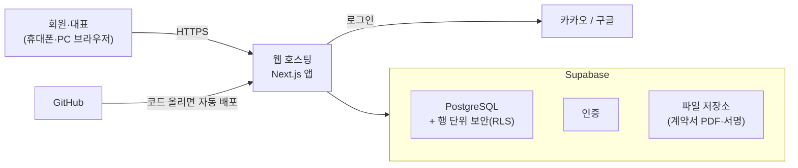

# 원스텝 인력관리 앱 기술 스택

| 항목 | 내용 |
|---|---|
| 문서 버전 | v0.1 (초안) |
| 최종 수정 | 2026-10-26 |
| 관련 문서 | [PRD](./PRD.md) · [ERD](./ERD.md) |

## 1. 선택 기준

1. **검증됨**: 사용자가 많고 문서·예제가 풍부해서, 막혔을 때 답을 찾기 쉬운 기술
2. **안전함**: 인증, 권한, 암호화를 직접 만들지 않고 검증된 기능을 쓴다.
3. **운영 부담이 적음**: 개발·유지보수 2인 중 1인이 초보자다. 서버를 직접 설치·관리하지 않는다.
4. **한 언어**: 화면부터 서버까지 TypeScript 하나로 작성한다.

## 2. 구성

| 영역 | 선택 | 하는 일 |
|---|---|---|
| 언어 | **TypeScript** | 자바스크립트에 타입 검사를 더한 언어. 실수를 코드 작성 단계에서 잡아 준다. |
| 웹 프레임워크 | **Next.js** (App Router) | 화면과 서버 기능을 한 프로젝트에서 만든다. |
| 화면 스타일 | **Tailwind CSS** + **shadcn/ui** | 버튼, 입력창, 표 같은 부품을 가져다 쓴다. 휴대폰·PC 화면 대응이 쉽다. |
| 데이터베이스 | **Supabase (PostgreSQL)** | 관계형 데이터베이스. 웹 관리 화면에서 데이터를 엑셀처럼 볼 수 있다. |
| 로그인 | **Supabase Auth** (카카오, 구글) | 카카오·구글 로그인을 기본 기능으로 지원한다. 비밀번호를 우리가 보관하지 않는다. |
| 권한 | **PostgreSQL RLS** | "회원은 자기 데이터만"이라는 규칙을 데이터베이스가 직접 지킨다. 화면 코드에 실수가 있어도 남의 데이터가 새지 않는다. |
| 파일 저장 | **Supabase Storage** (비공개) | 계약서 PDF, 서명 이미지 |
| 입력 검증 | **Zod** + **React Hook Form** | 휴대폰 번호, 주민번호 형식 등을 화면과 서버에서 똑같이 검사한다. |
| 암호화 | **Node.js 내장 crypto** (AES-256-GCM) | 주민번호·계좌번호 암호화. 외부 라이브러리 없이 표준 기능만 쓴다. |
| 계약서 PDF | **@react-pdf/renderer** + 한글 글꼴(Pretendard 또는 Noto Sans KR) | 서명된 계약서를 PDF로 만든다. |
| 손글씨 서명 | **signature_pad** | 화면에 손가락으로 서명한다. |
| 엑셀 | **ExcelJS** | 이체용 엑셀 만들기, 기존 명단 불러오기 |
| 배포 | **웹 호스팅** (Vercel Pro 또는 검증된 대안) | Next.js의 서버 기능을 실행한다. 호스팅을 정한 뒤 GitHub 자동 배포를 연결한다. |
| 앱 형태 | **PWA** | 웹사이트를 휴대폰 홈 화면에 앱처럼 설치한다. 웹 푸시 알림 가능 |
| 테스트 | **Vitest** (계산 로직), **Playwright** (화면 흐름) | 세금 계산처럼 틀리면 안 되는 부분부터 테스트한다. |
| 코드 품질 | **ESLint**, **Prettier** | 코드 실수 검사, 코드 모양 자동 정리 |

> 라이브러리 버전은 프로젝트를 만들 때 최신 안정 버전으로 고정한다.

## 3. 다른 선택지와 비교

| 선택지 | 장점 | 고르지 않은 이유 |
|---|---|---|
| Firebase | 무료로 시작, 자료 많음 | 문서형(NoSQL) DB라 일정 ↔ 신청 ↔ 계약 ↔ 정산처럼 서로 연결된 데이터를 다루기 불편. 카카오 로그인을 직접 구현해야 함 |
| 자체 서버 (Spring, Django + AWS 등) | 자유도 높음 | 서버 설치·보안 패치·백업을 직접 해야 함. 초보자에게 부담 |
| 노코드 (Bubble 등) | 개발 없이 빠름 | 주민번호 암호화, 계약서 PDF 같은 요구를 맞추기 어렵고, 나중에 다른 곳으로 옮기기 어려움 |
| 네이티브 앱 (React Native, Flutter) | 앱스토어 출시, 기기 기능 | 웹과 앱을 따로 관리해야 함. 사용성 검증 단계에는 과함. 필요해지면 PWA를 감싸서 출시 가능 |

## 4. 보안 설계

| 위험 | 대응 |
|---|---|
| 남의 데이터 조회 | 모든 테이블에 RLS 적용. 기본은 "모두 거부", 필요한 것만 허용 |
| 주민번호·계좌번호 유출 | 서버에서 AES-256-GCM 암호화 후 저장. 키는 선택한 서버 호스팅의 비밀 환경변수에만 보관(DB, GitHub에 두지 않음). 화면에는 마스킹 값만 |
| 관리자 키 노출 | Supabase 관리자 키(`service_role`)는 서버 코드에서만 사용하고 브라우저로 보내지 않는다. |
| 초대 없이 가입 | 로그인은 누구나 할 수 있어도, 서버가 초대 코드를 확인하고 대표가 승인해야만 회원이 된다. |
| 계약서 위·변조 | 서명 시점 문서의 SHA-256 해시 저장, 서명 시각·IP·기기 정보 기록 |
| 파일 직접 접근 | 비공개 저장소 + 짧은 시간만 유효한 다운로드 링크 |
| 비밀값 커밋 | `.env` 파일은 Git에서 제외. GitHub 비밀값 검사(secret scanning) 사용 |
| 라이브러리 취약점 | GitHub Dependabot으로 취약점 알림 받기 |

## 5. 로그인 연동 참고

| 항목 | 내용 |
|---|---|
| 카카오 로그인 | 카카오 개발자 사이트에 앱을 등록한다. 이메일 항목은 비즈 앱 전환(사업자 인증)이 필요하지만, 우리는 이메일 대신 휴대폰 번호를 신청서에서 받으므로 **이메일 없이 진행**한다. Supabase의 Kakao 설정에서 "Allow users without an email"을 켠다. |
| 구글 로그인 | 구글 클라우드 콘솔에서 OAuth 클라이언트를 만든다. |
| 카카오톡 인앱 브라우저 | 구글 로그인은 내장 브라우저에서 차단될 수 있다. 이 경우 외부 브라우저(Chrome, Safari)에서 여는 방법과 버튼을 안내한다. 기기마다 자동 전환이 보장되지는 않는다. 카카오 로그인도 대상 기기에서 실제 흐름을 시험한다. |

## 6. 비용과 운영 단계

**월 운영비**는 웹 호스팅, 데이터베이스, 파일 저장, 도메인 및 발송비를 포함한다. Vercel과 Supabase는 역할이 다르다. Vercel은 웹앱을 실행하는 호스팅 후보이고, Supabase는 DB·인증·파일 저장 후보이다. 현재 설계의 서버 기능(암호화·PDF·이체 엑셀 등)을 유지하려면 웹앱을 실행할 곳이 필요하지만, 반드시 Vercel일 필요는 없다.

| 단계 | 권장 구성 | 월 기본요금 | 전환 기준 |
|---|---|---|---|
| 개발·와이어프레임 | 로컬 Next.js + 테스트용 Supabase Free 또는 로컬 개발 환경 | 0원 가능 | 가짜 데이터로 로그인·초대·승인 흐름 확인 |
| 공개 시연·소규모 시험 | 상업적 사용 조건과 Next.js 서버 기능을 확인한 무료 호스팅 + Supabase Free | 0원 가능 | 실제 회사 업무·개인정보를 넣기 전에 가용성, 백업, 배포 제한을 확인 |
| 실제 계약·정산 운영 | 운영 조건을 충족하는 유료 웹 호스팅 + Supabase Pro 검토 | 비용 발생 | 실제 주민번호·계좌번호·계약서·지급 자료를 처리하기 전 복구 계획과 요금 확정 |

Vercel을 쓰는 경우 Hobby의 비상업적 사용 제한을 확인한다. 회사의 인력 모집·계약·정산에 쓰는 앱은 사용자에게 이용료를 받지 않더라도 회사 업무를 지원하므로, Hobby를 실제 업무용 무료 호스팅으로 전제하지 않는다. 무료 대안은 후보를 정한 후 해당 서비스의 최신 상업적 사용 조건, Next.js 서버 기능·Node.js `crypto` 호환성, 무료 요청량과 초과 시 동작을 검증해야 한다. 정적 웹 호스팅만 제공하는 상품에는 현재 서버 기능을 그대로 올릴 수 없다.

Supabase Free에는 무료 사용량 쿼터(DB 500MB, 월 활성 사용자 5만 명 등)가 있지만, 이 숫자만으로 550명 규모의 운영 적합성을 판단할 수 없다. 사용량이 적은 무료 프로젝트는 7일 동안의 활동을 기준으로 일시정지될 수 있으며, Free에는 자동 일일 DB 백업이 없다. 직접 백업할 경우 복구 시험도 필요하다. Supabase의 DB 백업에는 Storage에 저장한 계약서 PDF·서명 파일 자체가 포함되지 않으므로 파일 백업·복구 방법을 별도로 마련한다.

이전의 “월 약 $45”는 Vercel Pro와 Supabase Pro의 기본요금을 단순 합산한 예시일 뿐이다. 실제 청구액은 선택한 호스팅, 결제 단위, 프로젝트 수, 사용량, 환율·세금, 도메인·발송비에 따라 달라진다. 가격·정책은 가입 및 실제 데이터 투입 직전에 다시 확인한다.

공식 확인 자료: [Vercel 요금제](https://vercel.com/docs/plans/hobby) · [Supabase 요금](https://supabase.com/docs/guides/platform/billing-on-supabase) · [무료 프로젝트 일시정지](https://supabase.com/docs/guides/platform/free-project-pausing) · [백업 범위](https://supabase.com/docs/guides/platform/backups)

## 7. 시작 전에 준비할 계정

계정은 회사가 관리하는 조직으로 만들고 대표·개발자에게 개인별 권한을 부여한다. 가능한 계정에는 다중 인증을 켜고 비밀번호를 공동으로 사용하지 않는다.

| 계정 | 용도 | 만드는 곳 |
|---|---|---|
| GitHub | 코드 저장 (이미 있음) | github.com |
| Supabase | DB, 로그인, 파일 | supabase.com (GitHub 계정으로 가입 가능) |
| 웹 호스팅 계정 | 앱 배포. 서비스 후보를 정한 후 생성 | Vercel 또는 검증된 대안 |
| 카카오 개발자 | 카카오 로그인 | developers.kakao.com |
| 구글 클라우드 | 구글 로그인 | console.cloud.google.com |

## 8. 초보자를 위한 작업 방식
- 기능 하나를 만들 때마다 무엇을 왜 바꿨는지 설명과 함께 커밋한다.
- 데이터베이스 변경은 SQL 파일(마이그레이션)로 남겨서 언제든 같은 구조를 다시 만들 수 있게 한다.
- 실행 방법, 환경변수 설정, 배포 방법은 `README.md`에 단계별로 적는다.
- 처음에는 화면 문구나 단가 같은 쉬운 부분부터 직접 고쳐 보며 익힌다.
